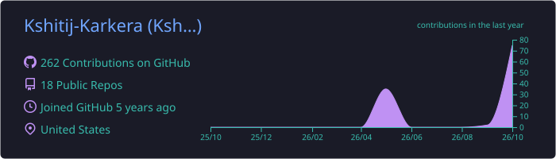
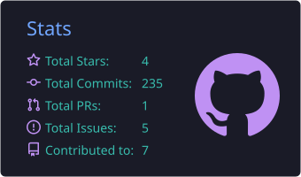
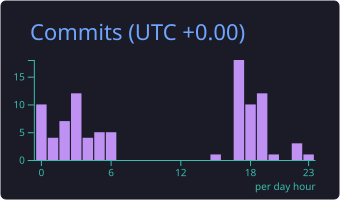
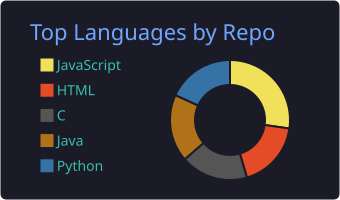
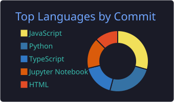

<!-- ===================== HEADER ===================== -->
<p align="center">
  
</p>

<p align="center">
  <a href="https://github.com/Kshitij-Karkera">
    
  </a>
</p>

<p align="center">
  <a href="https://www.linkedin.com/in/kshitij-karkera/"></a>
  <a href="https://twitter.com/KshitijKarkera"></a>
  <a href="https://stackoverflow.com/users/16016046/kshitij-karkera"></a>
</p>

<p align="center">
  
  
</p>

---

## 👨‍💻 About Me

```python
class KshitijKarkera:
    education  = "MS in Computer Science @ The University of Texas at Arlington"
    location   = "United States 🇺🇸"
    focus      = ["Software Engineering", "Data Engineering", "Cloud Computing", "AI/ML"]
    builds     = ["Full-stack web apps", "ML-powered products", "Data visualization tools"]
    open_to    = ["Software Engineering roles", "Data Engineering roles", "Internships / Co-ops"]

    def say_hi(self):
        print("Thanks for stopping by! Let's build something together.")
```

- 🎓 Pursuing my **MS in Computer Science at UT Arlington**
- 🧠 I like taking ML from a notebook to a real product, like a **PyTorch ResNet model served through FastAPI behind a React UI**
- 🌐 I build full-stack apps with **React, Node.js/Express, Django and SQL/NoSQL databases**
- ☁️ I work with **AWS, Docker and Kubernetes** for deployment
- 📊 I build interactive data visualizations with **D3.js and Chart.js**
- 🤝 I answer questions on **[Stack Overflow](https://stackoverflow.com/users/16016046/kshitij-karkera)**

---

## 🛠️ Tech Stack

**Languages**


**AI / ML & Data**


**Frontend**


**Backend**


**Databases**


**Cloud & DevOps**


---

## 🚀 Featured Projects

| Project | What it does | Stack | Highlights |
|---|---|---|---|
| 🌿 **[Plant Disease Detection](https://github.com/Kshitij-Karkera/Plant-Disease-Detection-with-React-and-Python)** | Upload a photo of a leaf and get a disease diagnosis | React · FastAPI · PyTorch | ResNet-based deep learning model served through a REST API into a React frontend |
| 🛒 **[E-commerce Website](https://github.com/Kshitij-Karkera/E-commerce-Website-in-React)** | Full online storefront | React.js | Responsive UI, dynamic product listings, user authentication and cart management |
| 📈 **[Cryptocurrency Price Data](https://github.com/Kshitij-Karkera/Cryptocurrency-Price-Data)** | Live and historical crypto price dashboard | JavaScript · D3.js · Binance API | Pulls live and historical prices and renders interactive D3.js charts |
| 🅿️ **[Park It Down](https://github.com/Kshitij-Karkera/Park-It-Down)** | Parking marketplace and management app | Django · Python · jQuery · MySQL | Role-based system for three user types, including sellers who lend out parking space |

---

## 📊 GitHub Stats

<!-- Cards below are generated daily by .github/workflows/profile-cards.yml -->
<p align="center">
  
</p>

<p align="center">
  
  
</p>

<p align="center">
  
  
</p>

<p align="center">
  
</p>

### 🐍 Contribution Snake

<p align="center">
  <picture>
    <source media="(prefers-color-scheme: dark)" srcset="https://raw.githubusercontent.com/Kshitij-Karkera/Kshitij-Karkera/output/github-snake-dark.svg" />
    <source media="(prefers-color-scheme: light)" srcset="https://raw.githubusercontent.com/Kshitij-Karkera/Kshitij-Karkera/output/github-snake.svg" />
    
  </picture>
</p>

---

## 🤝 Let's Connect

I'm **actively looking for Software Engineering, Data Engineering and AI/ML opportunities**.
If you're building something interesting, I'd love to hear from you on **[LinkedIn](https://www.linkedin.com/in/kshitij-karkera/)**.

<p align="center">
  
</p>
